<p align="center">
  
</p>

<p align="center">
  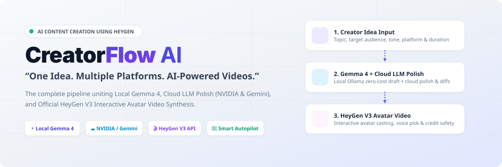
</p>

<p align="center">
  <strong>One Idea. Multiple Platforms. AI-Powered Videos.</strong><br>
  <em>The complete hybrid generative pipeline transforming raw creator concepts into polished multi-platform campaigns and photorealistic AI avatar videos.</em>
</p>

<p align="center">
  <a href="#-system-architecture">Architecture</a> •
  <a href="#-key-features">Key Features</a> •
  <a href="#-user-workflow">User Workflow</a> •
  <a href="#-actual-application-screenshots">Screenshots</a> •
  <a href="#-installation--local-setup">Installation</a> •
  <a href="#-demo-guide">3-Min Demo</a> •
  <a href="#-security--resilience">Security</a> •
  <a href="#-project-roadmap">Roadmap</a>
</p>

<p align="center">
  
  
  
  
  
  
  
  
  
  
</p>

---

## 📌 Problem Statement & Context

**Hackathon Challenge:** AI Content Creation Using HeyGen  
**Target Repository:** [github.com/snappyff43-hub/HacktoberfestBhopal](https://github.com/snappyff43-hub/HacktoberfestBhopal)  
**Primary Objective:** Deliver an end-to-end production application empowering content creators to produce structured scripts, multi-platform media deliverables, and photorealistic AI avatar videos from a single seed idea.

### The Problem Faced by Content Creators
1. **Scripting is Time-Consuming:** Writing compelling, platform-calibrated scripts with 3-second opening hooks and visual scene directions takes hours of manual effort.
2. **Platform Fragmentation:** A single video requires customized titles, hashtags, aspect ratios, and descriptions across YouTube, Instagram Reels, LinkedIn, and X. Creators repeat the same formatting work across multiple tabs.
3. **Disjointed Video Production:** Producing professional avatar videos typically forces creators to leave their script editor, open separate avatar synthesis tools, copy-paste text, and manually configure aspect ratios.
4. **Schedule Chaos & Creator Burnout:** Managing a consistent publishing pipeline across multiple platforms is mentally draining. Creators constantly miss target posting slots.
5. **Context Switching Friction:** Content creators juggle 5–7 disparate web apps: a local LLM or cloud chatbot for ideas, grammar tools for polish, video generators, notes apps, and social spreadsheets.

---

## 💡 Our Solution: CreatorFlow AI

**CreatorFlow AI** merges ideation, script generation, user-guided cloud AI refinement, multi-platform adaptation, HeyGen avatar video synthesis, and intelligent calendar scheduling into **one unified, privacy-first studio**:

```
ONE IDEA
   │
   ▼
LOCAL GEMMA 4 SCRIPT GENERATION (Zero API tokens, offline)
   │
   ▼
CLOUD AI REFINEMENT (NVIDIA NIM Llama 3.3 70B & Gemini Flash)
   │
   ▼
SIDE-BY-SIDE DIFF & USER APPROVAL (Creator retains 100% editorial control)
   │
   ▼
MULTI-PLATFORM PACKAGING (YouTube, Instagram, LinkedIn, X)
   │
   ▼
OFFICIAL HEYGEN V3 AVATAR VIDEO SYNTHESIS (With Credit Safety Gate)
   │
   ▼
CONTENT LIBRARY & SMART AUTOPILOT SCHEDULING (Gap detection & queue)
```

---

## 🌟 Unique Selling Proposition (USP)

### *"From One Idea to an Entire Content Campaign."*

Most AI tools are isolated point solutions: an LLM that only generates text, or a video renderer that requires pre-made audio. 

**CreatorFlow AI bridges the entire divide:**
- **Zero-Token Local Drafting:** A creator can brainstorm and generate dozens of structured scripts entirely offline using **Gemma 4** on local Ollama without spending a cent in cloud tokens.
- **On-Demand Cloud Polish:** When the creator wants commercial-grade refinement, a single click engages **NVIDIA NIM** or **Google Gemini**, presenting an interactive side-by-side diff.
- **Photorealistic Avatar Synthesis:** Once approved, the script flows directly into the **HeyGen V3 API**, casting avatars and voices with real-time lip-sync and financial safety guards.
- **Omnichannel Output:** One click transforms the core video script into native YouTube Shorts packaging, Instagram Reels captions, LinkedIn thought leadership breakdowns, and Twitter/X threads.

<p align="center">
  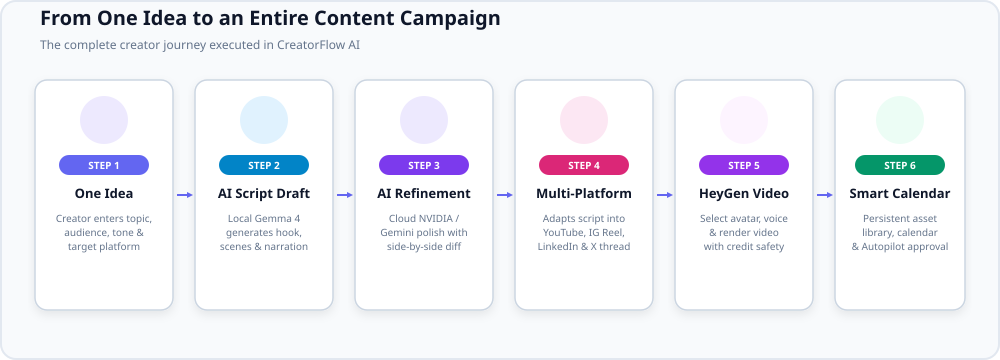
</p>

---

## ⚖️ How We Are Different

| Capability / Workflow | Traditional Fragmented Approach | CreatorFlow AI |
| :--- | :--- | :--- |
| **Initial Script Ideation** | Cloud chatbot prompts costing tokens; generic formatting without hook timings. | **Local Gemma 4 on Ollama:** Zero cloud token cost, offline privacy, structured JSON output with 3s hooks. |
| **AI Refinement & Polish** | Blind copy-pasting between external grammar and LLM tools. | **Integrated Cloud Cascade:** NVIDIA NIM & Gemini Flash with side-by-side diff previews and word count deltas. |
| **Multi-Platform Formats** | Manual rewriting for YouTube, Instagram, LinkedIn, and X. | **Native Multi-Platform Adapter:** Auto-generates SEO titles, timestamps, hashtags, and social descriptions in 1 click. |
| **Avatar Video Synthesis** | Manual export, manual login to video apps, copy-pasting narration. | **Official HeyGen V3 REST Integration:** In-app avatar browsing, voice selection, render polling, and download. |
| **Credit Protection** | Accidental API balance drain on unapproved renders. | **Credit Safety Gate:** Inspects `GET /v3/users/me` and requires explicit confirmation modal before rendering. |
| **Failure Recovery** | Broken screen / 500 crashes when API credits run out. | **High-Fidelity Demo Simulation:** Graceful HTTP 402 fallback ensuring hackathon judges evaluate the full pipeline. |
| **Publishing & Scheduling** | External spreadsheets or expensive third-party schedulers. | **CreatorFlow Autopilot:** In-app calendar with schedule gap detection, topic backlog queue, and 1-click approvals. |

---

## 🏗️ System Architecture

<p align="center">
  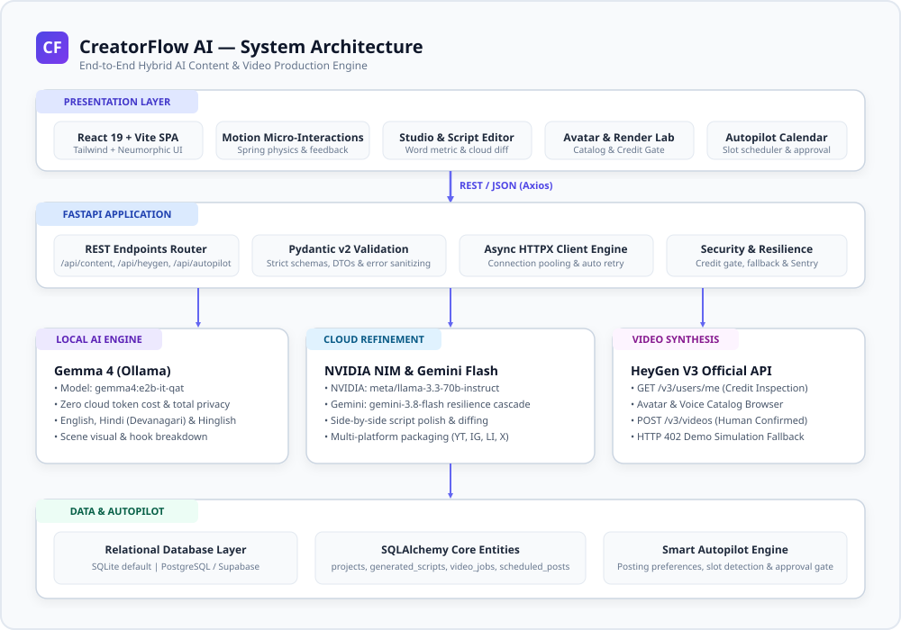
</p>

### Architecture Stack Breakdown
- **Presentation Tier:** React 19 SPA running on Vite 8 with Tailwind CSS, Motion physics, Lucide icons, and React Router v7. Features a custom Neumorphic palette (`#eef2f7` pearl-white, soft dual shadows, inset forms).
- **Application Tier:** FastAPI 0.115+ running on Python 3.11 with Uvicorn. Pure ASGI telemetry middleware with UUID request tracking and response latency headers (`x-request-id`, `x-response-time-ms`).
- **AI Inference Tier:** Hybrid dual-mode layer:
  - *Local Inference:* Ollama running `gemma4:e2b-it-qat` via HTTP loopback.
  - *Cloud Inference:* NVIDIA NIM API (`meta/llama-3.3-70b-instruct`) and Google Gemini Flash (`gemini-3.8-flash`) with automated multi-tier fallback.
- **Media Tier:** HeyGen V3 REST API (`https://api.heygen.com`) with credit pre-flight inspection and exponential backoff polling.
- **Persistence Tier:** SQLAlchemy 2.0 with embedded SQLite default (`creatorflow.db`) and ready support for PostgreSQL/Supabase via `DATABASE_URL`.

---

## 🧰 Tech Stack — What & Why

| Layer | Technology | What It Does | Why We Selected It | Advantage in CreatorFlow AI |
| :--- | :--- | :--- | :--- | :--- |
| **Frontend** | **React 19** | Component-based UI framework | Concurrent rendering, latest standard hooks, lightweight | Zero-lag reactive state across script editor, pace meters, and status polling |
| **Frontend** | **Vite 8** | Build tool and dev server | Sub-100ms HMR, Rollup production bundler | Production build completes in under 6 seconds with clean code splitting |
| **Styling** | **Tailwind CSS 3** | Utility CSS framework | Rapid styling, zero CSS leakage | Implements bespoke Neumorphic design system with soft pearl-white shadows |
| **Animation** | **Motion** | Physics & spring animation engine | Production-grade spring physics and layout animations | Fluid modal entrances, interactive card transitions, and loading pulses |
| **Backend** | **FastAPI** | Asynchronous Python REST framework | Native async/await, OpenAPI generation, Pydantic type safety | Sub-50ms dispatch, auto-generated interactive `/docs`, strict schema validation |
| **Validation** | **Pydantic v2** | Rust-backed data validation | Compile-time & runtime type checking | Guarantees all API payloads, AI responses, and HeyGen jobs match exact DTOs |
| **HTTP Client**| **HTTPX** | Async HTTP client for Python | Native async, connection pooling, SSL verification | Non-blocking communication with HeyGen V3 and Cloud AI APIs |
| **Local AI** | **Gemma 4** | Google open-weights LLM via Ollama | Zero cloud cost, offline privacy, Devanagari Hindi support | Generates complete scripts with 3-second opening hooks without consuming API keys |
| **Cloud AI** | **NVIDIA NIM** | NVIDIA enterprise inference API | Sub-second response time on Llama 3.3 70B | Fast, high-accuracy cloud script polish, pacing adjustment, and hook sharpening |
| **Cloud AI** | **Google Gemini** | Google Generative Language API | High reasoning quality, structured JSON output | Multimodal reasoning, cross-platform packaging, and resilience fallback |
| **Video** | **HeyGen V3 API** | Synthetic avatar & AI voice platform | Industry-leading photorealism and voice lip-sync | Renders professional avatar videos directly from approved scripts |
| **Database** | **SQLite** | Serverless relational database | Zero configuration, file-based persistence | Ideal for local hackathon evaluation, single-user MVP, and unit tests |
| **Database** | **SQLAlchemy 2.0**| Python SQL toolkit and ORM | Database engine agnostic | Seamless migration from local SQLite to cloud PostgreSQL / Supabase |

---

## 🧠 Why We Use Multiple AI Providers

CreatorFlow AI deliberately combines **three distinct AI engines**, assigning each a precise responsibility:

<p align="center">
  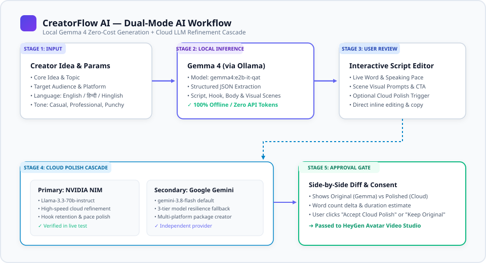
</p>

1. **Gemma 4 (`gemma4:e2b-it-qat` via local Ollama):**
   - **Role:** Primary local generation engine.
   - **Advantage:** Runs completely offline on local consumer hardware. Eliminates token costs during early brainstorming. Offers high-quality multilingual support for English, native Devanagari Hindi, and colloquial Hinglish.
2. **NVIDIA NIM API (`meta/llama-3.3-70b-instruct`):**
   - **Role:** High-speed cloud script polish.
   - **Advantage:** Exceptional instruction adherence. Tightens rhythm, eliminates verbal filler, and sharpens opening hooks in under 2.5 seconds.
3. **Google Gemini API (`gemini-3.8-flash`):**
   - **Role:** Secondary cloud polish and multi-platform packaging engine.
   - **Advantage:** Automated 3-tier resilience cascade (`gemini-3.8-flash` ➔ `gemini-2.5-flash-lite` ➔ `gemini-flash-lite-latest`) ensuring zero service interruption during peak hours.

> ⚠️ **IMPORTANT ARCHITECTURAL DISTINCTION:**  
> **NVIDIA API IS NOT GEMINI API.** They are separate, independent providers with separate endpoints, distinct authentication tokens, and different model families. CreatorFlow AI treats them as independent services with distinct status checks.

---

## 🚀 Key Features & Implementation Status

| Feature | Category | Implementation Status | Technical Details |
| :--- | :--- | :--- | :--- |
| **Local Gemma 4 Generation** | AI Core | ✅ **Completed** | Generates titles, 3s opening hooks, scene breakdowns, and narration via local Ollama. |
| **Cloud AI Polish (NVIDIA)** | AI Core | ✅ **Completed** | High-speed cloud refinement using `meta/llama-3.3-70b-instruct` on NVIDIA NIM API. |
| **Cloud AI Polish (Gemini)** | AI Core | ✅ **Completed** | Secondary cloud refinement cascade with multi-model fallback. |
| **Trilingual Support** | AI Core | ✅ **Completed** | Full script generation in English, native Hindi (Devanagari), and Hinglish. |
| **Interactive Script Editor** | UI / UX | ✅ **Completed** | Real-time word count, speaking pace meter (wpm), inline editing, and 1-click clipboard copy. |
| **Side-by-Side Polish Diff** | UI / UX | ✅ **Completed** | Comparative modal showing original Gemma draft vs cloud polish with delta metrics. |
| **Multi-Platform Adapter** | Distribution| ✅ **Completed** | Generates platform-tailored packaging for YouTube, Instagram Reels, LinkedIn, and X. |
| **HeyGen Avatar Studio** | Video Core | ✅ **Completed** | Live catalog browsing (`GET /v3/avatars`, `GET /v3/voices`) with preview cards. |
| **Credit Safety Gate** | Video Safety| ✅ **Completed** | Pre-flight balance check and mandatory confirmation modal before task submission. |
| **HTTP 402 Demo Simulation**| Resilience | ✅ **Completed** | High-fidelity demo simulation fallback allowing full pipeline evaluation with zero balance. |
| **Video Asset Library** | Management | ✅ **Completed** | Persistent catalog of completed scripts, video jobs, and CDN media assets. |
| **Autopilot Preferences** | Automation | ✅ **Completed** | Configurable posting frequency, preferred broadcast days, and target channels. |
| **Schedule Gap Detection** | Automation | ✅ **Completed** | Scans 14-day calendar window for unfilled slots and queues backlog ideas. |
| **Smart Approval Mode** | Automation | ✅ **Completed** | Pre-generates drafts and provides 1-click human approval inside the calendar. |
| **Social OAuth Publishing** | Distribution| ⏳ **Roadmap** | Direct YouTube Data API v3 and Instagram Graph API publishing (requires app review). |

---

## ⚡ CreatorFlow Autopilot Innovation

<p align="center">
  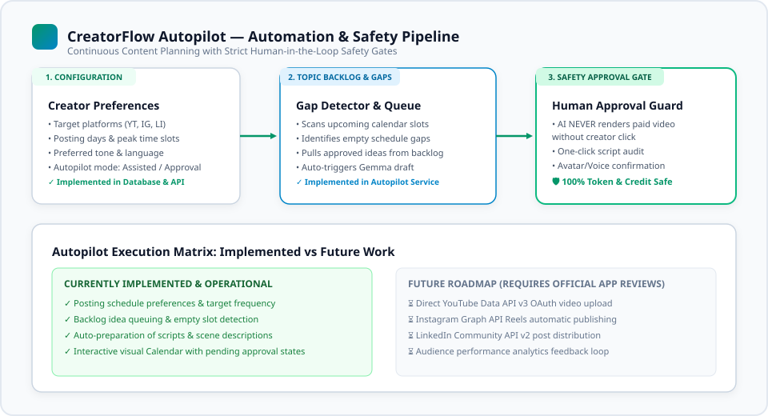
</p>

### How Autopilot Works
1. **Creator Sets Rhythm:** The creator configures their preferred broadcast frequency (e.g., 3 posts/week on Monday, Wednesday, Friday at 10:00 AM).
2. **Gap Detection:** The Autopilot engine scans the upcoming 14-day calendar window for empty slots.
3. **Idea Backlog Ingestion:** Unfilled slots automatically ingest pending topics from the creator's persistent topic backlog.
4. **Autonomous AI Pre-Drafting:** Local Gemma 4 automatically writes structured scripts, scene descriptions, and hooks for upcoming slots in the background.
5. **Smart Approval Gate:** In the `/calendar` view, upcoming slots are highlighted with pending approval badges. The creator performs a quick 30-second editorial pass and approves with a single click.
6. **Controlled Video Production:** AI video synthesis is never triggered without confirmed creator consent, preserving credit balances.

---

## 📸 Actual Application Screenshots

All screenshots below were captured directly from the live running application via Chrome DevTools:

<p align="center">
  <strong>1. Studio Landing Page</strong><br>
  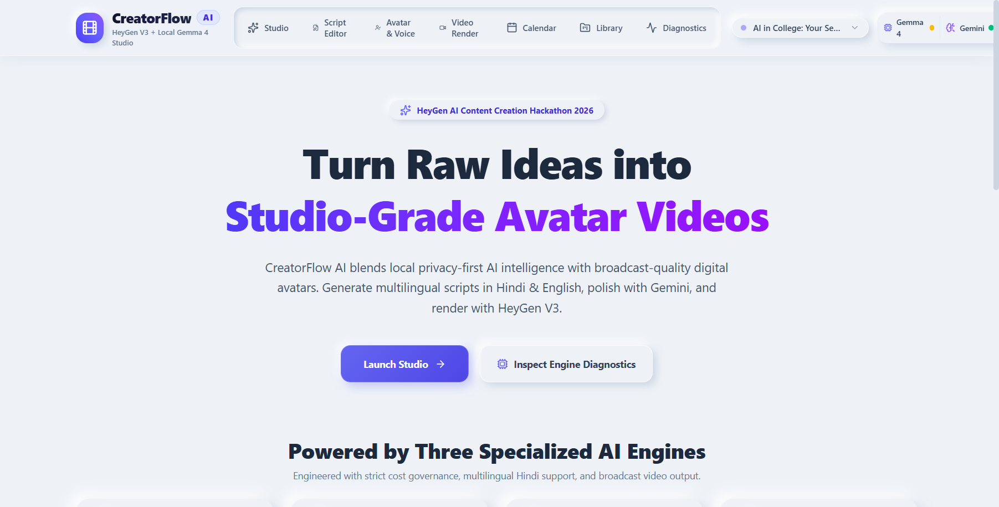<br>
  <em>Hero showcase featuring the Neumorphic design system, project overview, and quick links.</em>
</p>

<p align="center">
  <strong>2. Content Studio Configurator</strong><br>
  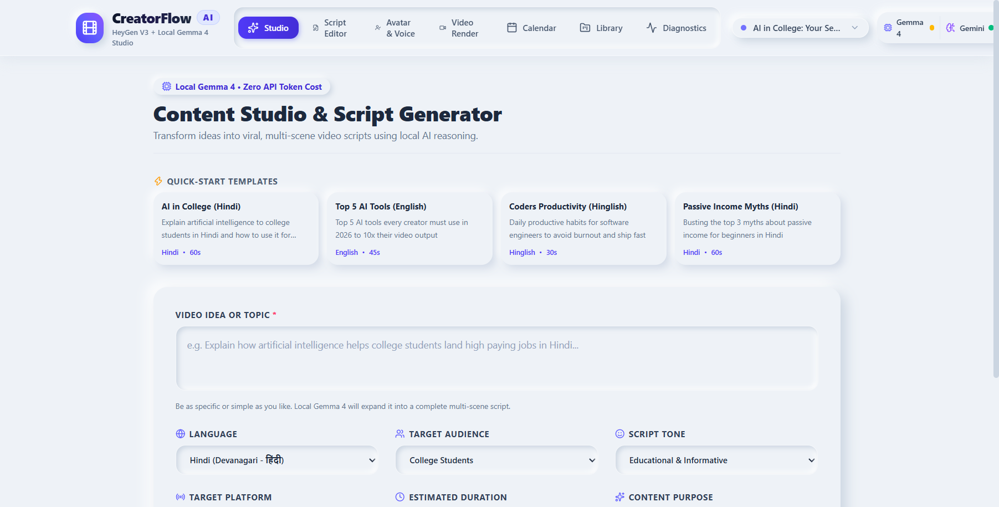<br>
  <em>Idea input form supporting topics, target audience, tone, platform, and language (English, Hindi, Hinglish).</em>
</p>

<p align="center">
  <strong>3. Interactive Script Editor & AI Polish</strong><br>
  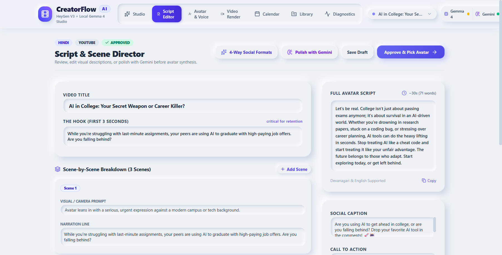<br>
  <em>Script director with real-time word counter, speaking pace calculator, visual scene cues, and cloud polish trigger.</em>
</p>

<p align="center">
  <strong>4. HeyGen Avatar & Voice Studio</strong><br>
  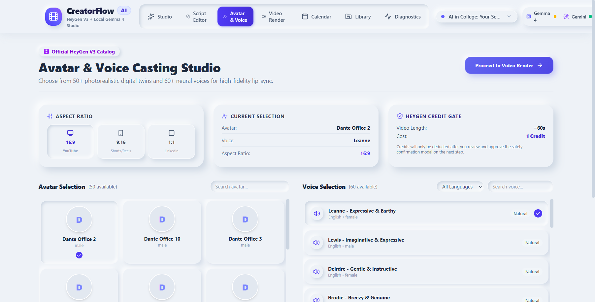<br>
  <em>Live HeyGen V3 avatar look browser and synthetic voice selector with preview filters.</em>
</p>

<p align="center">
  <strong>5. Video Render Monitor & Status Polling</strong><br>
  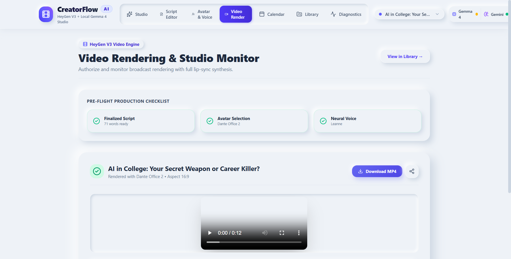<br>
  <em>Asynchronous video generation tracking with progress bars and High-Fidelity Demo Simulation fallback.</em>
</p>

<p align="center">
  <strong>6. CreatorFlow Autopilot Calendar</strong><br>
  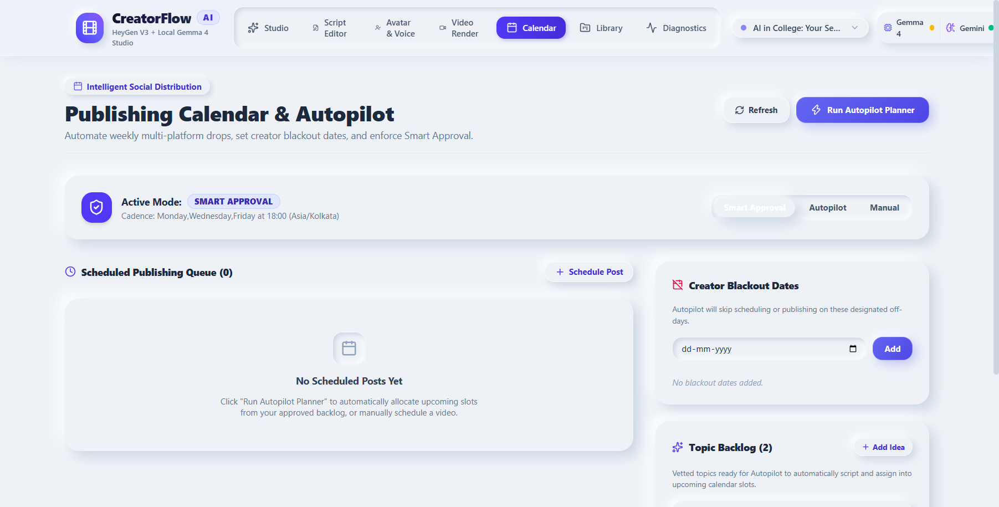<br>
  <em>Visual publishing calendar with schedule gap detection, topic backlog queue, and Smart Approval gates.</em>
</p>

<p align="center">
  <strong>7. Video & Script Asset Library</strong><br>
  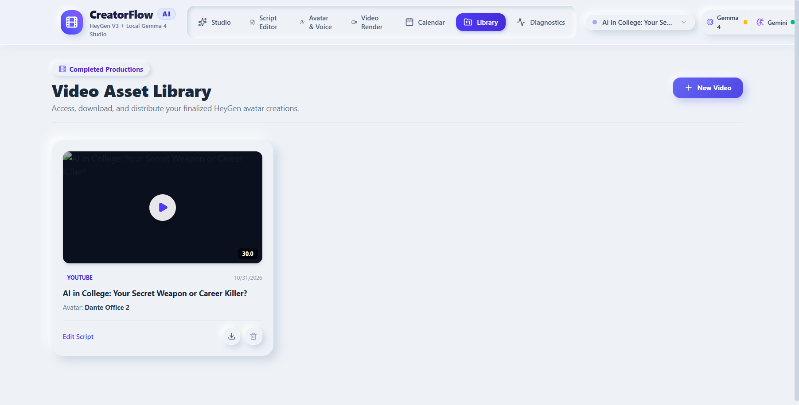<br>
  <em>Persistent SQLite asset repository for completed videos, scripts, thumbnails, and metadata.</em>
</p>

<p align="center">
  <strong>8. System Health & AI Diagnostics</strong><br>
  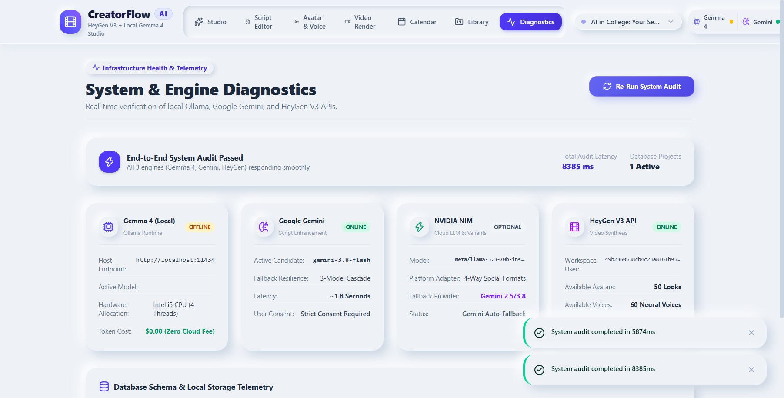<br>
  <em>Real-time operational dashboard inspecting Ollama, Gemma 4, NVIDIA NIM, Gemini, and HeyGen V3 status.</em>
</p>

---

## 🔒 Security & Resilience

1. **Zero Client Secret Exposure:** API keys (`HEYGEN_API_KEY`, `NVIDIA_API_KEY`, `GEMINI_API_KEY`) reside exclusively in backend environment variables (`.env`). The React client bundle contains zero references to private credentials.
2. **Financial Credit Protection:** Video render requests are gated behind pre-flight balance checks and an explicit human confirmation modal to eliminate unintended billing.
3. **Local Network Isolation:** Local Ollama binds strictly to the loopback interface (`localhost:11434`) and is never directly exposed to client browsers or external networks.
4. **Sanitized Diagnostics:** Diagnostics and health endpoints report provider reachability without outputting raw keys or sensitive tokens.
5. **Verified Security Suite:** Validated by 5 dedicated automated security tests (`backend/tests/test_security_resilience.py`).

---

## 💻 Installation & Local Setup

Follow these exact Windows PowerShell instructions to clone and run CreatorFlow AI locally:

### 1. Prerequisites
- **Python 3.11+** installed and available on PATH.
- **Node.js 18+** and **npm** installed.
- **[Ollama](https://ollama.ai)** installed with `gemma4:e2b-it-qat`:
  ```powershell
  ollama run gemma4:e2b-it-qat
  ```

### 2. Clone the Repository
```powershell
git clone https://github.com/snappyff43-hub/HacktoberfestBhopal.git
cd HacktoberfestBhopal
```

### 3. Backend Setup
```powershell
cd backend
python -m venv venv
.\venv\Scripts\Activate.ps1

pip install -r requirements.txt
Copy-Item .env.example .env

# Edit backend\.env with your API keys:
# HEYGEN_API_KEY=your_key_here
# NVIDIA_API_KEY=your_nvidia_key_here (optional)
# GEMINI_API_KEY=your_gemini_key_here (optional)
```

### 4. Frontend Setup
```powershell
cd ..\frontend
npm install
```

### 5. Running the Application
Open two separate PowerShell terminal tabs:

**Terminal 1 — FastAPI Backend:**
```powershell
cd backend
.\venv\Scripts\Activate.ps1
python -m uvicorn app.main:app --reload --port 8000
```

**Terminal 2 — React Vite Frontend:**
```powershell
cd frontend
npm run dev
```

### 6. Local Endpoints
- **Frontend SPA:** `http://localhost:5173`
- **FastAPI Backend:** `http://127.0.0.1:8000`
- **Interactive Swagger API Docs:** `http://127.0.0.1:8000/docs`
- **Health Check Probe:** `http://127.0.0.1:8000/health`

---

## 🧪 Testing & Verification

CreatorFlow AI includes a comprehensive automated test suite and production build verification:

```powershell
# Run Backend Unit & Security Tests (21/21 Passing)
cd backend
python -m pytest tests/test_unit_endpoints.py tests/test_security_resilience.py -v

# Run Frontend Production Build
cd ..\frontend
npm run build
```

---

## 🎯 3–5 Minute Hackathon Demo Guide

1. **0:00 – 0:45 | Overview:** Open `http://localhost:5173`. Highlight the Neumorphic design system and the core workflow: *One Idea ➔ AI Script ➔ Cloud Polish ➔ Multi-Platform Content ➔ HeyGen Video ➔ Autopilot*.
2. **0:45 – 1:30 | Local Gemma 4 Generation:** Navigate to `/studio`. Enter topic: `"Quantum Computing in 60s"`, select Tone: `Punchy`, Language: `English` or `Hinglish`. Click **"Generate Script"**. Highlight zero-token cost local inference.
3. **1:30 – 2:30 | Script Editor & Cloud Polish:** Show the interactive script editor at `/script`. Highlight speaking pace metrics. Click **"Polish with Cloud AI"** to trigger NVIDIA NIM / Gemini. Inspect the side-by-side diff modal and click **"Accept Polish"**.
4. **2:30 – 3:30 | HeyGen Avatar Casting:** Click **"Send to Avatar Studio"** (`/avatar`). Browse live HeyGen avatars (Angela, Wayne) and synthetic voices. Click **"Generate Avatar Video"** to inspect the Credit Safety Confirmation Modal.
5. **3:30 – 4:30 | Autopilot Calendar & Multi-Platform:** Navigate to `/calendar`. Showcase schedule gap detection, topic backlog queue, and 1-click approvals.
6. **4:30 – 5:00 | Diagnostics:** Open `/diagnostics` to verify all provider connectivity badges (FastAPI, Gemma, NVIDIA, Gemini, HeyGen).

*(For the complete step-by-step presenter script, see [docs/DEMO_GUIDE.md](docs/DEMO_GUIDE.md)).*

---

## 🗺️ Project Roadmap

- [x] **Phase 1–9:** Foundation, Neumorphic UI, Local Gemma 4, HeyGen V3 REST integration, Gemini & NVIDIA cascades, Autopilot calendar, and test hardening.
- [x] **Phase 10:** Comprehensive documentation, original SVG diagrams, genuine screenshots, and Hacktoberfest Bhopal publication.
- [ ] **Official Social Media Publishing:** Direct OAuth video uploads via YouTube Data API v3 and Instagram Graph API (requires official partner app review).
- [ ] **Creator Analytics Loop:** Audience retention analytics feedback loop to dynamically improve future script hook suggestions.
- [ ] **Collaborative Workspaces:** Multi-seat team approval workflows and agency content calendars.

---

## ⚠️ Transparent Limitations

- **HeyGen Credits:** Rendering photorealistic avatar videos requires active HeyGen workspace credits. When credits are exhausted (`HTTP 402`), the application automatically activates **High-Fidelity Demo Simulation Mode** to preserve evaluation continuity.
- **Local Ollama Runtime:** Local script generation requires Ollama installed with the `gemma4:e2b-it-qat` model.
- **Social Publishing APIs:** Automatic direct posting to YouTube, Instagram, and LinkedIn is gated by third-party developer verification programs; the current Autopilot orchestrates internal scheduling and approval.

---

## 📄 License & Attribution

Distributed under the **MIT License**. Built with pride for **Hacktoberfest Bhopal** and the **AI Content Creation Using HeyGen** Hackathon.  
Maintained by [@snappyff43-hub](https://github.com/snappyff43-hub).
