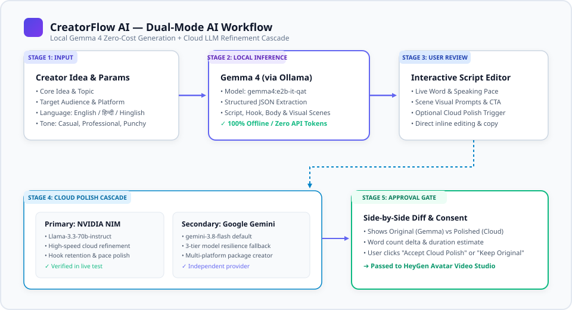

# CreatorFlow AI — Dual-Mode AI Workflow & Provider Engine

> **In-depth guide to local Gemma 4 generation, cloud NVIDIA/Gemini polish cascades, and side-by-side script refinement.**

---

## 1. The Dual-Mode AI Philosophy

Content creation demands two contrasting qualities:
1. **Speed, Privacy, & Cost-Effectiveness:** Ideation and drafting should be instant, private, and cost-free.
2. **Refinement, Nuance, & Reasoning:** Final publication demands high-polish rhetoric, platform-specific hook dynamics, and pacing adjustments.

To satisfy both requirements without forcing tradeoffs, CreatorFlow AI implements a **Dual-Mode AI Architecture**:

```
                       [ CREATOR INPUT ]
                    Topic, Audience, Platform,
                     Language (EN / HI / Hinglish)
                                │
                                ▼
                   [ LOCAL GEMMA 4 (OLLAMA) ]
                    • gemma4:e2b-it-qat
                    • Zero API tokens / Offline
                    • 3-8s structured JSON output
                                │
                                ▼
                 [ INTERACTIVE SCRIPT EDITOR ]
                  • Word & pace metrics
                  • Scene prompts & visual cues
                  • Inline editing
                                │
            ┌───────────────────┴───────────────────┐
            ▼                                       ▼
  [ KEEP GEMMA SCRIPT ]                [ REQUEST CLOUD POLISH ]
  Proceed immediately                         │
  to Avatar Studio                             ▼
                                   [ CLOUD CASCADE ]
                             Primary: NVIDIA NIM (Llama 3.3 70B)
                             Secondary: Gemini 3.8 Flash
                                               │
                                               ▼
                                   [ SIDE-BY-SIDE DIFF ]
                                    • Original vs Polished
                                    • Word count delta
                                    • Specific hook improvements
                                               │
                                               ▼
                                      [ CREATOR APPROVAL ]
                                               │
                                               ▼
                                 [ HEYGEN V3 AVATAR STUDIO ]
```



---

## 2. Layer 1: Local Gemma 4 Generation

### 2.1 Model & Runtime
- **Runtime:** [Ollama](https://ollama.ai) daemon running on `http://localhost:11434`.
- **Model:** `gemma4:e2b-it-qat` (Google Gemma 4, Quantized Instruction-Tuned).
- **Endpoint:** `POST /api/generate` with structured JSON format enforcement.

### 2.2 Output Schema
Gemma generates a strictly structured JSON response containing:
```json
{
  "title": "Quantum Computing Explained in 60 Seconds",
  "opening_hook": "What if your laptop could test every password in the universe at the exact same moment?",
  "target_duration_seconds": 60,
  "narration_script": "Traditional computers process bits as zeros or ones...",
  "visual_scenes": [
    {
      "scene_number": 1,
      "timestamp": "0:00 - 0:05",
      "visual_description": "Close-up of talking avatar with glowing quantum particle animation in background",
      "narration_segment": "What if your laptop could test every password in the universe at the exact same moment?"
    }
  ],
  "hashtags": ["#QuantumComputing", "#TechExplainers", "#LearnFast"],
  "call_to_action": "Follow CreatorFlow AI for more 60-second tech deep dives!"
}
```

### 2.3 Multilingual Capabilities
- **English:** Clean, energetic pacing calibrated for 130–150 words per minute.
- **Hindi (Devanagari):** Authentic Devanagari script syntax without broken grammatical artifacts.
- **Hinglish:** Natural conversational bilingual blend commonly used by Indian creators (e.g., *"Aaj hum samajhne waale hain Quantum Computing ka basic concept, woh bhi bina kisi complicated math ke..."*).

---

## 3. Layer 2: Cloud Refinement Cascade

### 3.1 Primary Cloud Engine: NVIDIA NIM API
- **Endpoint:** `https://integrate.api.nvidia.com/v1/chat/completions`
- **Model:** `meta/llama-3.3-70b-instruct`
- **Key Characteristics:**
  - Fast response times (<2.5 seconds).
  - Preserves the core messaging of the local draft while tightening rhythm, eliminating filler, and sharpening the opening 3-second hook.
  - Implemented in `backend/app/services/nvidia_service.py`.

### 3.2 Secondary Cloud Engine: Google Gemini API
- **Model:** `gemini-3.8-flash`
- **Fallback Models:** `gemini-2.5-flash-lite`, `gemini-flash-lite-latest`
- **Key Characteristics:**
  - Automated 3-tier resilience cascade: if a newer model encounters rate limiting or version deprecation, the system seamlessly downgrades to adjacent tiers.
  - Generates cross-platform package variants (YouTube, Instagram, LinkedIn, X).
  - Implemented in `backend/app/services/gemini_service.py`.

---

## 4. Side-by-Side Review & Human Approval

The application strictly enforces a **Human-in-the-Loop** model:
1. When Cloud AI refinement completes, the frontend does **not** silently overwrite the creator's text.
2. A side-by-side comparative diff modal is rendered:
   - **Left Column:** Original Gemma 4 script with word count and estimated speaking duration.
   - **Right Column:** Cloud-refined script with highlighted modifications, pace improvements, and hook updates.
3. The creator has three explicit choices:
   - **Accept Cloud Polish:** Adopts the refined script as the active project script.
   - **Keep Original:** Discards the cloud polish with zero modification.
   - **Manual Edit:** Tweak any sentence directly in the interactive Script Editor.
