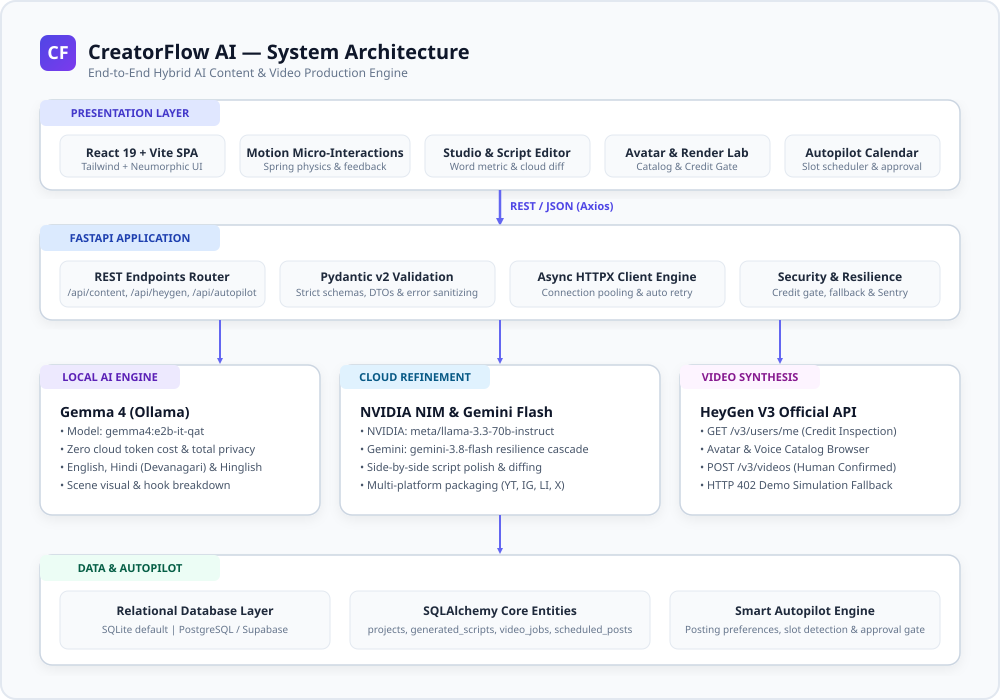
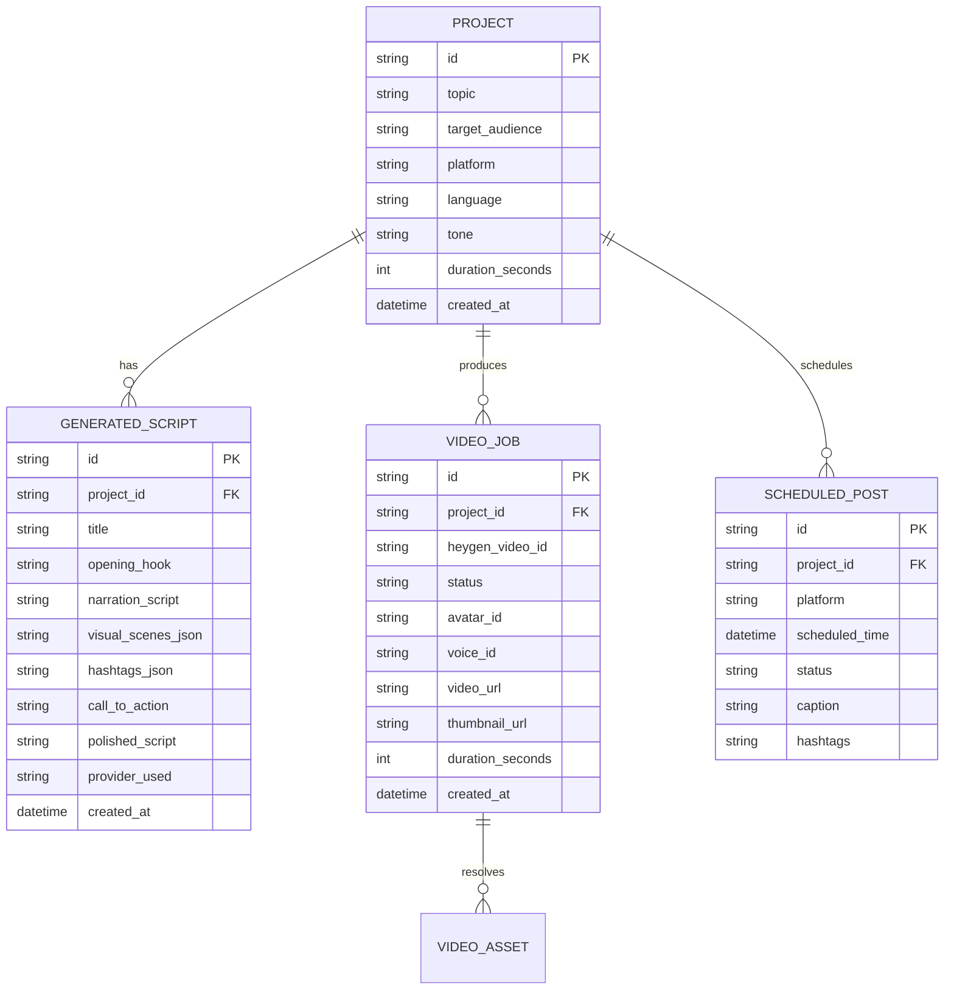

# CreatorFlow AI — System Architecture

> **Comprehensive Technical Blueprint & Data Flow Specification**

---

## 1. Executive Architecture Overview

CreatorFlow AI employs a modern **hybrid client-server architecture** designed specifically for real-time AI-assisted content production. It couples an ultra-fast local generative loop (via **Gemma 4** running offline on local **Ollama**) with cloud-scale refinement (**NVIDIA NIM API** and **Google Gemini Flash**) and high-fidelity video synthesis (**HeyGen V3 REST API**).

```
React 19 + Tailwind Frontend (Client)
                  │  HTTP / JSON (Axios)
                  ▼
         FastAPI Backend Router
                  │
      ┌───────────┴───────────┐
      ▼                       ▼
AI Provider Layer       Video Synthesis Layer
(Gemma 4 / NVIDIA /      (HeyGen V3 Official API)
 Google Gemini API)           │
      │                       ▼
      ▼               Asset Persistence
Relational DB Layer     (SQLite / PostgreSQL)
(SQLAlchemy Models)           │
                              ▼
                      Autopilot Scheduler
```



---

## 2. Layer-by-Layer Architecture

### 2.1 Presentation Layer (Frontend)
- **Framework:** React 19 SPA bootstrapped with Vite 8.
- **Styling System:** Tailwind CSS with a customized **Neumorphic design system** (`#eef2f7` base canvas, double-diffused soft drop shadows, inset interactive form controls, indigo `#6366f1` and lavender `#a855f7` primary accents).
- **Animation Engine:** Motion (`motion/react`) for spring-physics entrances, layout transitions, modal focus traps, and real-time generation pulses.
- **Routing:** React Router v7 providing clean navigation between:
  - `/` — Hero Landing Page & Feature Showcase
  - `/studio` — Studio Content Configurator (Topic, Audience, Tone, Platform, Duration)
  - `/script` — Interactive Script Director & Side-by-Side Cloud AI Refinement Diff
  - `/avatar` — HeyGen Avatar Casting & Voice Studio Catalog
  - `/render` — Video Render Monitor & Status Polling Engine
  - `/calendar` — Autopilot Publishing Calendar & Approval Queue
  - `/library` — Generated Video & Script Asset Library
  - `/diagnostics` — System Health & AI Provider Connectivity Diagnostic Suite

### 2.2 Application Backend Layer (FastAPI)
- **Language & Runtime:** Python 3.11 with FastAPI 0.115+ and Uvicorn.
- **Data Validation & DTOs:** Pydantic v2 schemas providing strict compile-time and runtime validation for all API inputs and responses.
- **Telemetry & Logging:** Pure ASGI `LoggingMiddleware` injecting a unique `x-request-id` UUID and `x-response-time-ms` latency metric into every HTTP response.
- **Monitoring:** Integrated Sentry error monitoring handler (auto-activates when `SENTRY_DSN` is populated, gracefully silent when unconfigured).
- **Database Engine:** SQLAlchemy 2.0 with connection pooling and support for SQLite (zero-config local default) and PostgreSQL / Supabase for cloud production.

### 2.3 AI Provider Layer (Hybrid Dual-Mode)

| AI Component | Provider / Runtime | Model Identifier | Role & Implementation |
| :--- | :--- | :--- | :--- |
| **Local Script Generator** | Ollama (Local Daemon) | `gemma4:e2b-it-qat` | Zero-token cost, offline-first generation of titles, 3s opening hooks, scene breakdowns, and narration scripts in English, Hindi, and Hinglish. |
| **Cloud Script Refinement** | NVIDIA NIM API | `meta/llama-3.3-70b-instruct` | Cloud-grade high-speed script polish, pacing adjustment, and hook sharpening with structured diffing. |
| **Cloud Script Secondary** | Google Gemini API | `gemini-3.8-flash` | Resilience fallback cascade (`gemini-3.8-flash` -> `gemini-2.5-flash-lite` -> `gemini-flash-lite-latest`) for multi-platform packaging. |

### 2.4 HeyGen V3 Video Synthesis Layer
- **Protocol:** Official HeyGen V3 REST API (`https://api.heygen.com`).
- **Authentication:** `x-api-key` header managed exclusively server-side.
- **Pre-flight Credit Safety Gate:** Proactively checks `GET /v3/users/me` before any render task is scheduled to inspect quota.
- **Human Confirmation Enforced:** Client requires an explicit user modal confirmation before initiating video generation.
- **Graceful HTTP 402 Handling:** When credits are exhausted (`402 Payment Required`), the backend catches the status code and transitions into **High-Fidelity Demo Simulation Mode**, returning high-resolution animated avatar preview mockups so judges and developers can evaluate the complete user journey without payment friction.

---

## 3. Data Schema & Entities

The SQLAlchemy relational database layer manages four primary operational entities:



---

## 4. End-to-End Request Pipeline

1. **Idea Dispatch:** The frontend sends a structured POST payload to `/api/content/generate`.
2. **Gemma Draft:** FastAPI invokes `gemma_service.py` to query local Ollama, returning a structured JSON script draft within 3–8 seconds.
3. **Interactive Script Review:** The creator reviews the script in `/script`, inspecting word count, duration, and visual cues.
4. **Cloud AI Polish (Optional):** Creator clicks "Polish with Cloud AI". FastAPI forwards the draft to NVIDIA NIM (`nvidia_service.py`) or Gemini (`gemini_service.py`), generating a side-by-side diff.
5. **Approval:** Creator approves or edits the script.
6. **Avatar Selection:** Creator selects an avatar look and synthetic voice in `/avatar`.
7. **Credit Gate:** System inspects user credits via `heygen_service.py`.
8. **Video Task Submission:** Video generation is submitted to HeyGen V3. Progress polling tracks the video through rendering to completion.
9. **Asset Storage:** Output video URL, thumbnail, and script metadata are stored in the database and surfaced in `/library` and `/calendar`.
