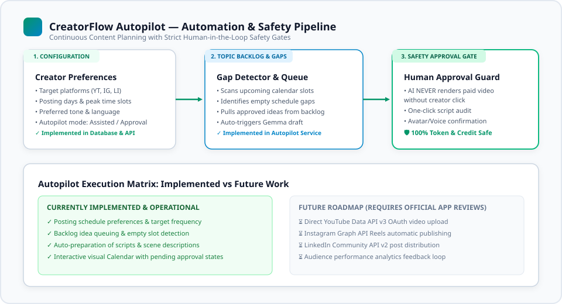

# CreatorFlow Autopilot — Architecture & Implementation

> **Continuous Content Planning with Strict Human-in-the-Loop Safety Gates**

---

## 1. Vision & The Creator Consistency Problem

The single largest barrier to creator success is **publishing consistency**. Creators experience burnout because:
1. Brainstorming, drafting, reviewing, voice casting, and scheduling require 5–7 separate manual steps per video.
2. Inconsistent posting cadence damages platform algorithmic distribution.
3. Fully autonomous tools produce low-quality, generic spam that damages creator brand equity.

**CreatorFlow Autopilot** solves this dilemma through **Assisted Automation with Human Approval Gates**: the machine handles ideation, gap detection, and drafting, while the creator retains complete veto authority and final editorial signoff.

```
+-------------------------------------------------------------+
|                 CREATOR PREFERENCES                         |
|   Target Platforms • Posting Cadence • Preferred Tone       |
+-------------------------------------------------------------+
                              │
                              ▼
+-------------------------------------------------------------+
|               CALENDAR GAP & BACKLOG SCANNER                |
|       Identifies empty slots across next 7-14 days          |
+-------------------------------------------------------------+
                              │
                              ▼
+-------------------------------------------------------------+
|                 AI DRAFT PRE-GENERATION                     |
|    Local Gemma 4 generates structured script & scene cues    |
+-------------------------------------------------------------+
                              │
                              ▼
+-------------------------------------------------------------+
|                 SMART APPROVAL QUEUE (HUMAN)                |
|      Creator reviews, tweaks, and gives 1-click approval     |
+-------------------------------------------------------------+
                              │
                              ▼
+-------------------------------------------------------------+
|               HEYGEN V3 AVATAR VIDEO SYNTHESIS              |
|        Renders only upon explicit confirmed consent         |
+-------------------------------------------------------------+
```



---

## 2. Core Implemented Components

### 2.1 Creator Preferences (`CreatorPreference` Model)
Persisted in the database via SQLAlchemy:
- `posting_frequency`: Posts per week (e.g., 3, 5, 7).
- `preferred_days`: Array of active days (e.g., `["Monday", "Wednesday", "Friday"]`).
- `preferred_time_slots`: Target broadcast hours (e.g., `["10:00 AM", "06:00 PM"]`).
- `platforms`: Active distribution channels (`YouTube`, `Instagram`, `LinkedIn`, `Twitter`).
- `auto_generate_drafts`: Boolean flag controlling background draft preparation.
- `autopilot_mode`: `assisted` (drafts prepared, approval required) vs `manual`.

### 2.2 Topic Backlog (`TopicBacklog` Model)
A persistent queue of ideas and concepts ready for production:
- Topics can be added manually or imported from creator brainstorming sessions.
- Status tracking: `pending` ➔ `drafted` ➔ `approved` ➔ `produced`.

### 2.3 Calendar Gap Detector (`autopilot_service.py`)
- Analyzes existing `ScheduledPost` records against the creator's preferred schedule.
- Identifies unfilled slots over the subsequent 14-day window.
- Automatically claims the highest-priority pending idea from the backlog and dispatches a Gemma 4 generation job to prepare the script in advance.

### 2.4 Smart Approval Mode
- Implemented in `/calendar` UI.
- Displays upcoming scheduled slots with a status badge: `Pending Approval`, `Draft Ready`, `Video Rendered`, or `Scheduled`.
- Creators can preview the full script, inspect visual cues, and click **"Approve & Schedule"** with a single click.

---

## 3. Implementation Status & Social API Honesty

| Feature | Implementation Status | Implementation Notes |
| :--- | :--- | :--- |
| **Posting Preference Configuration** | ✅ **Fully Implemented** | Database models, REST endpoints, and UI controls in `/calendar`. |
| **Schedule Gap Detection** | ✅ **Fully Implemented** | `autopilot_service.py` calculates upcoming slot deficits. |
| **Topic Backlog Queuing** | ✅ **Fully Implemented** | CRUD endpoints at `/api/autopilot/backlog`. |
| **AI Script Pre-drafting** | ✅ **Fully Implemented** | Local Gemma 4 generates scripts for empty calendar slots. |
| **Interactive Calendar UI** | ✅ **Fully Implemented** | React UI with day-by-day slot management and approval actions. |
| **HeyGen Video Triggering** | ✅ **Fully Implemented** | One-click transition from approved script to HeyGen studio. |
| **YouTube Data API v3 Auto-Upload** | ⏳ **Planned Roadmap** | Requires official Google Cloud OAuth App Verification and quota. |
| **Instagram Graph API Publishing** | ⏳ **Planned Roadmap** | Requires Meta App Review and Instagram Business Account link. |
| **LinkedIn Community API v2** | ⏳ **Planned Roadmap** | Requires LinkedIn Developer App verification and token handling. |

> **Transparency Note:**  
> CreatorFlow AI does **not** simulate fake automated publishing to live social feeds. The calendar orchestrates the entire internal preparation, approval, and video production pipeline. Final social distribution APIs remain clearly demarcated as future roadmap integrations.
